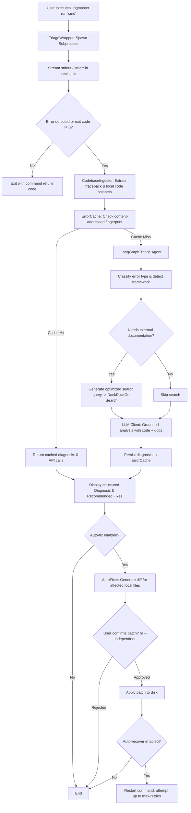

# AI LogMaster

A command-line execution wrapper and error triage agent that monitors process execution, captures failures in real time, correlates stack traces with your local codebase and live official documentation, and generates root-cause diagnoses with verified code patches.

[](https://pypi.org/project/ai-logmaster/)
[](https://www.python.org/downloads/)
[](LICENSE)

---

## What AI LogMaster Is (and Is Not)

To prevent confusion, here is a direct comparison of what this tool is designed to do:

| What It Is | What It Is Not |
|---|---|
| **A process wrapper CLI**: Runs any shell command (Python, Node.js, Go, bash, build tools, test runners) as a child process and observes standard output / standard error streams. | **Not an APM or background daemon**: It is not a permanent system monitor like Datadog, Prometheus, or New Relic. It only runs when you execute a command through it. |
| **A real-time error triage agent**: Detects crashes, exceptions, and non-zero exit codes, capturing the failure context and traceback. | **Not an in-process bytecode tracer**: It does not monkey-patch runtimes or inspect internal object memory. It works via process I/O and traceback analysis. |
| **A context-aware analyzer**: Extracts local source files referenced in the traceback and pulls official library documentation from the web to give the LLM accurate context. | **Not a cloud SaaS**: It has no hosted server or telemetry backend. All requests go directly to your configured provider or local offline model. |
| **A content-addressed solution cache**: Hashes normalized error signatures to return instant fixes for known errors without spending LLM API credits. | **Not a linter or static analyzer**: It does not replace tools like Ruff, Flake8, ESLint, or Mypy. It activates upon runtime failure. |
| **An interactive code repair utility**: Displays unified diffs of proposed code fixes and requests explicit user confirmation before touching files on disk. | **Not an uncontrolled auto-writer**: It never silently overwrites source files unless explicitly configured in headless mode (`--independent`). |

---

## Execution Flow

When you run a command via `logmaster run "<command>"`, the execution follows this lifecycle:



---

## Core Features

- **Process-Agnostic Wrapping**: Wrap Python scripts, Node.js servers, compilation steps, or test suites without altering your source code.
- **Traceback and Local Code Ingestion**: Parses Python tracebacks to identify user-owned files and line numbers. It extracts surrounding code snippets while filtering out virtual environment and standard library paths, ensuring the LLM understands your actual code structure.
- **Content-Addressed Error Cache**: Normalizes error messages (stripping volatile machine paths, line numbers, and memory addresses) and computes an MD5 signature fingerprint. Repeated errors across different files or sessions resolve instantly at zero token cost.
- **Dynamic Documentation Retrieval**: Identifies over 20 frameworks (FastAPI, Django, Flask, PyTorch, SQLAlchemy, Celery, Pandas, etc.), uses the LLM to construct a targeted search query, and fetches relevant official documentation via DuckDuckGo before diagnosing the root cause.
- **Structured Root-Cause Diagnosis**: Returns a formatted report outlining the error category, root cause explanation, ordered remediation steps, and documentation reference URLs.
- **Interactive Code Repair (Auto-Fix)**: Generates unified diffs for the failing files. By default, it presents the diff and asks for confirmation (`[y/N]`) before writing to disk.
- **Auto-Recovery Loop**: When configured with `--auto-recover`, it automatically restarts the command after applying a patch, allowing headless recovery up to a configurable retry limit.
- **Zero-Dependency Configuration Dashboard**: Launch a local web UI via `logmaster init` to manage API keys, configure model parameters, and test API connectivity across multiple providers using Python standard library HTTP services.
- **Multi-Provider & Local LLM Support**: Supports Groq, OpenAI, Anthropic, Google Gemini, NVIDIA, and OpenAI-compatible local runtimes (Ollama, LM Studio, vLLM).
- **JSON Output Mode**: Pass `--json` to output clean machine-readable diagnostic payloads suitable for CI/CD pipelines, IDE extensions, or external monitoring workflows.

---

## Installation

### From PyPI

```bash
pip install ai-logmaster
```

### Optional Extras

For enhanced document scraping and FAISS vector index capabilities:

```bash
pip install "ai-logmaster[rag]"
```

For development and test dependencies:

```bash
pip install "ai-logmaster[dev]"
```

### From Source

```bash
git clone https://github.com/Divodude/ai-logmaster.git
cd ai-logmaster
pip install -e .
```

---

## Quick Start

### 1. Configure Provider & Model

Run the built-in configuration dashboard:

```bash
logmaster init
```

This starts a lightweight local server at `http://127.0.0.1:5894` and opens your browser. Select your preferred provider, enter your API key, select or type a model, click **Test Connection** to verify credentials, and click **Save**.

Alternatively, set your API key as an environment variable:

```bash
# Example for Groq
export GROQ_API_KEY="your-api-key"

# Example for OpenAI
export OPENAI_API_KEY="your-api-key"

# Example for Anthropic
export ANTHROPIC_API_KEY="your-api-key"
```

### 2. Run a Command

Wrap your application command with `logmaster run`:

```bash
logmaster run "python app.py"
```

If the command succeeds, LogMaster exits with status code `0`. If an error occurs, LogMaster captures the output, analyzes the root cause, and prints a diagnostic summary:

```text
[TRIAGE] Executing: python app.py
============================================================
[OUTPUT] Starting application server...
[ERROR]  TypeError: unsupported operand type(s) for /: 'int' and 'str'
============================================================

[TRIAGE] Error detected! Analyzing...
[AGENT] Classifying error type...
[AGENT] Error type: type, Needs docs: True
[AGENT] Detected library: python
[AGENT] Fetching documentation from web...
[AGENT] [OK] Fetched 1847 chars of documentation
[AGENT] Analyzing with AI...
[AGENT] [OK] Analysis complete (API calls: 1)

╔══════════════════════════════════════════════════════════╗
║ DIAGNOSIS                                                ║
╠══════════════════════════════════════════════════════════╣
║ Type: TypeError                                          ║
║ Confidence: 90%                                          ║
║ Method: AI + Docs                                        ║
╠══════════════════════════════════════════════════════════╣
║ ROOT CAUSE                                               ║
╠══════════════════════════════════════════════════════════╣
║ Division operation attempted between an integer and a    ║
║ string variable in calculation routine.                  ║
╠══════════════════════════════════════════════════════════╣
║ RECOMMENDED FIXES                                        ║
╠══════════════════════════════════════════════════════════╣
║ 1. Cast the denominator explicitly using float(val)      ║
║ 2. Validate input types prior to arithmetic execution    ║
║ 3. Handle ValueError if string parsing fails             ║
╚══════════════════════════════════════════════════════════╝
```

### 3. Interactive Code Patching

To have AI LogMaster inspect the affected source files and propose a patch:

```bash
logmaster run "python app.py" --auto-fix
```

When an error is caught, LogMaster displays a colored unified diff and asks:

```text
[AUTO_FIXER] Generating fix for: /path/to/app.py
--- /path/to/app.py (original)
+++ /path/to/app.py (proposed)
@@ -14,3 +14,3 @@
-    rate = total / duration
+    rate = total / float(duration) if duration else 0.0

Apply this fix? [y/N]:
```

If confirmed (`y`), the file is updated immediately.

---

## CLI Reference

### `logmaster init`

Starts the configuration dashboard server.

```bash
logmaster init [options]
```

| Flag | Type | Default | Description |
|---|---|---|---|
| `--port` | integer | `5894` | Local port to bind the configuration web server. |
| `--no-browser` | flag | `false` | Start server without automatically launching a web browser. |

### `logmaster run`

Executes and monitors a command.

```bash
logmaster run "<command>" [options]
```

| Flag | Type | Default | Description |
|---|---|---|---|
| `cmd` | string (positional) | *required* | The exact command to execute (enclose in quotes). |
| `--buffer` | integer | `100` | Number of trailing output lines maintained in memory for context. |
| `--auto-fix` | flag | `false` | Enable automated code patch generation with interactive diff confirmation. |
| `--independent` | flag | `false` | Apply generated code patches immediately without interactive human confirmation. |
| `--auto-recover` | flag | `false` | Automatically restart the command after a patch is applied. |
| `--max-retries` | integer | `3` | Maximum retry attempts for the auto-recovery loop. |
| `--json` | flag | `false` | Suppress human-readable formatting and output JSON to stdout. |

---

## Configuration

Configuration is stored in `~/.ai-logmaster/config.json`. You can manage this file through `logmaster init` or by editing it directly:

```json
{
  "ai": {
    "provider": "groq",
    "model": "llama-3.3-70b-versatile",
    "api_key": "${GROQ_API_KEY}",
    "temperature": 0.2,
    "max_tokens": 1024,
    "base_url": ""
  },
  "agent": {
    "use_cached_solutions": true,
    "fetch_documentation": true,
    "use_ai_analysis": true,
    "auto_fix": false,
    "independent_auto_fix": false,
    "auto_recover": false,
    "max_retries": 3,
    "cached_error_types": ["connection", "import", "memory", "timeout", "permission"],
    "complex_error_types": ["syntax", "type", "value", "unknown"]
  },
  "documentation": {
    "enable_search": true,
    "search_engine": "duckduckgo"
  },
  "output": {
    "verbose": true,
    "show_api_calls": true
  }
}
```

### Supported Providers

| Provider | Recommended Models | Environment Variable | Notes |
|---|---|---|---|
| **Groq** | `llama-3.3-70b-versatile`, `llama-3.1-8b-instant` | `GROQ_API_KEY` | Default cloud provider, fast inference. |
| **OpenAI** | `gpt-4o`, `gpt-4o-mini` | `OPENAI_API_KEY` | High reasoning fidelity. |
| **Anthropic** | `claude-3-5-sonnet-20241022`, `claude-3-haiku-20240307` | `ANTHROPIC_API_KEY` | Strong code analysis and diff accuracy. |
| **Google** | `gemini-2.5-flash`, `gemini-2.5-pro` | `GOOGLE_API_KEY` | Large context window support. |
| **NVIDIA** | `meta/llama-3.1-405b-instruct` | `NVIDIA_API_KEY` | OpenAI-compatible endpoint. |
| **Ollama (Local)** | `llama3.2`, `qwen2.5-coder-7b-instruct` | Not required | Set `base_url` to `http://localhost:11434/v1`. |
| **LM Studio (Local)** | Any loaded model | Not required | Set `base_url` to `http://localhost:1234/v1`. |

---

## Running with Local Models

You can run AI LogMaster entirely offline without sending logs to cloud APIs.

### 1. Using Ollama

Start your local model:

```bash
ollama run qwen2.5-coder:7b
```

Configure `~/.ai-logmaster/config.json`:

```json
{
  "ai": {
    "provider": "ollama",
    "model": "qwen2.5-coder:7b",
    "base_url": "http://localhost:11434/v1",
    "api_key": "local"
  }
}
```

### 2. Using LM Studio

1. Load your model in LM Studio.
2. Navigate to the **Local Server** tab and start the server at port `1234`.
3. In `~/.ai-logmaster/config.json`, set:

```json
{
  "ai": {
    "provider": "lm_studio",
    "model": "local-model",
    "base_url": "http://localhost:1234/v1",
    "api_key": "local"
  }
}
```

See [benchmarks/README.md](benchmarks/README.md) for community-submitted speed, accuracy, and hardware configurations for local runtimes.

---

## Automation & CI/CD Integration

### Headless Auto-Repair in CI

To run tests in a build pipeline with autonomous repair attempts:

```bash
logmaster run "pytest tests/" --auto-fix --independent --auto-recover --max-retries 2
```

### JSON Output for Pipeline Scripting

Use `--json` to receive structured machine-readable analysis:

```bash
logmaster run "python worker.py" --json
```

Example JSON output:

```json
{
  "type": "TypeError",
  "cause": "Division operation between integer and string",
  "fixes": [
    "Ensure divisor is numeric type",
    "Convert string to int/float if needed",
    "Validate inputs before operations"
  ],
  "confidence": 0.9,
  "method": "AI + Docs",
  "api_calls_used": 1,
  "exit_code": 1,
  "error_detected": true,
  "success": true
}
```

---

## Programmatic Python API

AI LogMaster can also be imported as a Python library to analyze error logs programmatically.

### Analyzing Log Strings

```python
from ai_logmaster import ErrorAnalyzer

analyzer = ErrorAnalyzer()

log_snippet = """
Traceback (most recent call last):
  File "calculator.py", line 12, in compute
    return total / items
ZeroDivisionError: division by zero
"""

result = analyzer.analyze(log_snippet)

print("Type:", result.get("type"))
print("Cause:", result.get("cause"))
print("Fixes:", result.get("fixes"))
print("Method:", result.get("method"))
print("API Calls:", result.get("api_calls_used", 0))
```

### Standalone Classification

Classify error categories and determine if external documentation is required without invoking an LLM:

```python
from ai_logmaster.core.classifier import ErrorClassifier

classifier = ErrorClassifier()
error_type, needs_docs = classifier.classify("ImportError: cannot import name 'FastAPI'")

print(error_type)   # "import"
print(needs_docs)   # False (resolvable via static cache)
```

### Standalone Documentation Retrieval

```python
from ai_logmaster.core.doc_fetcher import DocumentationFetcher

fetcher = DocumentationFetcher()
detected_lib = fetcher.detect_library("from sqlalchemy.orm import Session")
print(detected_lib)  # "sqlalchemy"
```

---

## Docker Support

You can run AI LogMaster via Docker to monitor containerized tasks:

```bash
# Build the container
docker compose build

# Run a command inside the mounted workspace
docker compose run --rm logmaster run "python your_script.py"
```

Your host directory is mounted at `/workspace` so LogMaster can read local source code for contextual analysis.

---

## Development & Testing

Clone the repository and install development dependencies:

```bash
git clone https://github.com/Divodude/ai-logmaster.git
cd ai-logmaster
pip install -e ".[dev]"
```

Run the unit test suite:

```bash
python -m unittest discover -s tests -p "test_*.py"
```

---

## Contributing

Contributions are welcome. Areas of active interest:

1. **Local LLM Benchmarks**: Test new open-source models with Ollama / LM Studio and submit results using the template in [benchmarks/TEMPLATE.md](benchmarks/TEMPLATE.md).
2. **Library Detection Keywords**: Add new framework detection patterns in `ai_logmaster/config/library_keywords.json`.
3. **Pattern Cache Rules**: Add standard, zero-API solutions for common runtime errors in `ai_logmaster/config/cached_solutions.json`.

Please open an issue or submit a pull request with appropriate unit tests.

---

## License

This project is licensed under the [MIT License](LICENSE).
